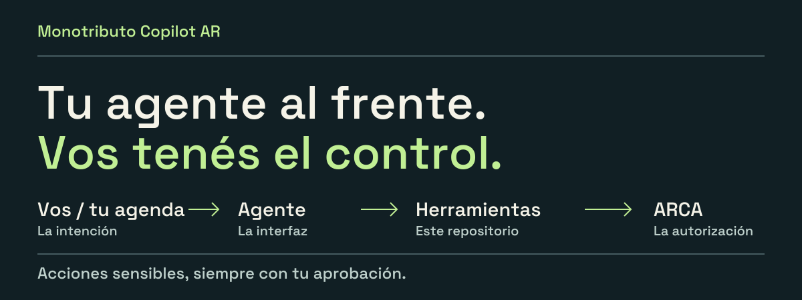

<picture>
  <source media="(max-width: 640px)" srcset="assets/cover-mobile.svg">
  
</picture>

# Monotributo Copilot AR

**Herramientas abiertas para que un agente de IA prepare facturas y revise tu monotributo, con evidencia y aprobación humana.**

[Entender la idea](#la-idea-en-un-minuto) · [Ver un ejemplo](#así-se-usaría) · [Probarlo](#inicio-rápido-seguro) · [Contribuir](CONTRIBUTING.md)

## La idea en un minuto

En lugar de aprender comandos o abrir otra app para cada control, hablás con un
agente. El agente usa las herramientas de este repositorio para preparar facturas,
revisar la información disponible y explicar qué falta. **Antes de una acción
sensible, se detiene para pedirte aprobación.**

Pensalo como una caja de herramientas: **el agente es la interfaz; este repo es
la base que ejecuta y deja registro**. La conversación, el calendario y las
notificaciones los aporta el entorno donde corre ese agente —por ejemplo, Codex
u OpenClaw—, no el repositorio por sí solo.

## Así se usaría

Ejemplo ilustrativo del flujo, no una conversación real ni una promesa de integración lista para usar:

> **Vos:** «Prepará las facturas de este mes y revisá si hay algo para atender».
>
> **Agente:** Usa la skill incluida, revisa las fuentes y prepara una simulación:
> destinatarios, importes, períodos y datos faltantes. No emite nada todavía.
>
> **Vos:** Revisás la propuesta y aprobás una emisión específica.
>
> **Agente:** Ejecuta esa acción, verifica la respuesta de ARCA y guarda el
> comprobante autorizado. Si el resultado es incierto, no reintenta a ciegas.

También puede preparar un reporte de control **sin emitir ni pagar nada**.
Si falta una fuente, lo dice: «no verificado» nunca se convierte en «deuda cero».

## Qué incluye hoy

| Necesidad | Qué aporta el repositorio |
|---|---|
| **Preparar facturas** | Simulación sin emisión, Factura C de servicios en pesos y PDF después de la autorización. |
| **Revisar ingresos y categoría** | Historial de comprobantes, ventana de doce meses y comparación con topes versionados. |
| **Controlar pagos y deuda** | Reporte a partir de una captura de la cuenta corriente (CCMA), con fecha y cobertura explícitas. |
| **Preparar una recategorización** | Expediente para revisión; no presenta el trámite por vos. |
| **Registrar avisos fiscales** | Registro mínimo de alertas del Domicilio Fiscal Electrónico (DFE); no abre ni responde comunicaciones. |
| **Operar con agentes** | [Skill incluida](skills/monotributo-copilot-ar/SKILL.md), comandos y archivos JSON/Markdown que otros agentes pueden usar. |

Hay funciones que consultan ARCA por sus servicios web y otras que necesitan
archivos importados. **No todas las fuentes se obtienen automáticamente.**

## Hasta dónde llega

- **Es una base para construir, no un contador autónomo instalado.** Hace falta
  configurar las fuentes y el entorno del agente. No es una app comercial.
- **No genera ni paga VEP, no reasigna saldos y no presenta recategorizaciones.**
  Puede preparar información para revisar, pero esos trámites quedan fuera de la automatización.
- **No navega ARCA desatendidamente ni almacena tu Clave Fiscal.** Los certificados
  y datos reales se mantienen en archivos locales ignorados por Git.
- **No reemplaza la responsabilidad profesional.** Intimaciones, defensas,
  certificaciones y decisiones fiscales extraordinarias requieren intervención profesional.

> No es asesoramiento contable ni jurídico. El proyecto no está afiliado,
> respaldado ni mantenido por ARCA.

## Para quién es

**Si querés entender el proyecto:** el ejemplo de arriba es el punto de partida.
No necesitás conocer TypeScript para entender qué se delega y qué sigue bajo tu control.

**Si querés probarlo o adaptarlo:** es un proyecto para desarrolladores y personas
que operan agentes con acceso a comandos y archivos. Podés empezar con datos de
muestra, sin credenciales reales. La [guía de agentes](docs/agent-interface.md)
explica cómo conectar intención, herramientas y aprobaciones.

---

## Requisitos

- Node.js 20 o superior.
- OpenSSL para generar una clave y un CSR.
- Para conectarse: certificado de ARCA y punto de venta habilitado.
- Para experimentar localmente no hacen falta credenciales reales.

## Inicio rápido seguro

```bash
git clone https://github.com/MatiasJRB/monotributo-copilot-ar.git
cd monotributo-copilot-ar
npm ci
cp env.example .env
npm test
npm run check
```

El archivo `.env` empieza en homologación. No completes datos reales hasta leer
[Seguridad](SECURITY.md) y [Operación](docs/operations.md).

### Operarlo con un agente

Instalá o vinculá la carpeta `skills/monotributo-copilot-ar` en el directorio de
skills de tu agente y pedile, por ejemplo:

> Revisá mi situación mensual de monotributo. Empezá por fuentes read-only,
> marcá todo dato faltante y prepará cualquier acción sensible para mi aprobación.

El contrato completo está en [Interfaz de agentes](docs/agent-interface.md).

### Probar el motor fiscal con ejemplos

```bash
npm run fiscal -- report \
  --as-of 2026-09-10 \
  --portal-history examples/fiscal/portal-history.example.csv \
  --portal-from 2025-09-01 \
  --portal-to 2026-09-10 \
  --finance-summary examples/fiscal/finance-summary.example.json \
  --payments-ledger examples/fiscal/payments.example.csv \
  --ccma examples/fiscal/ccma.example.json \
  --recategorization-parameters examples/fiscal/recategorization-parameters.example.json \
  --current-category B \
  --output-dir /tmp/monotributo-copilot-demo
```

### Probar la preparación de una factura sin emitir

Copiá el fixture a la ubicación de datos ignorada por Git:

```bash
mkdir -p data/billing/2026-08
cp examples/billing/2026-08/facturacion_dev.csv data/billing/2026-08/
npm run arca:dry-run -- --periodo 2026-08 --cliente cliente-demo --source dev
```

## Comandos

| Comando | Efecto |
|---|---|
| `npm run doctor` | Verifica configuración sin mostrar secretos |
| `npm run arca:status` | Consulta el estado de WSFE |
| `npm run arca:last` | Consulta el último comprobante |
| `npm run arca:dry-run` | Prepara request y preview; no emite |
| `npm run arca:emit-homo` | Emite únicamente en homologación |
| `npm run arca:render-pdf` | Regenera un PDF desde una respuesta aceptada |
| `npm run fiscal -- history …` | Descarga historial WSFE |
| `npm run fiscal -- report …` | Construye reporte desde fuentes explícitas |
| `npm run fiscal -- sync-report …` | Consulta y genera el reporte |
| `npm run dfe -- merge …` | Mezcla metadata mínima de alertas DFE |

La emisión productiva existe, pero no tiene un alias corto deliberadamente. Consultá
la operación completa antes de usarla.

## Arquitectura

```text
Persona --> agente + skill --> CLI / JSON
                              |
ARCA WSFE ---------> historial normalizado -----+
Export del portal -> importador CSV ------------+--> motor fiscal puro --> reporte al agente
Resumen financiero anonimizado -----------------+
Snapshot CCMA -----------------------------------+
Metadata DFE --> registro mínimo por excepción --+

Agente --> CSV de facturación --> dry-run --> aprobación humana --> WSFE --> verificación --> PDF
```

El código no automatiza el portal de ARCA, no almacena Clave Fiscal y no incorpora
un navegador desatendido.

## Documentación

- [Especificación](docs/spec.md)
- [Arquitectura](docs/architecture.md)
- [Interfaz de agentes](docs/agent-interface.md)
- [Operación](docs/operations.md)
- [Roadmap](docs/roadmap.md)
- [Seguridad](SECURITY.md)
- [Contribuir](CONTRIBUTING.md)

## Licencia

MIT. El proyecto no está afiliado, respaldado ni mantenido por ARCA.
